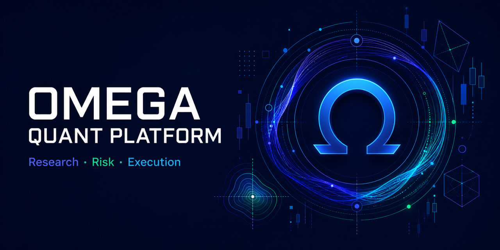
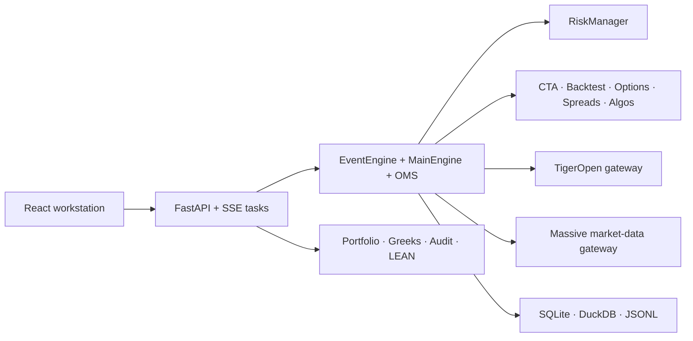

# Omega Quant Platform

[](https://github.com/RobbieRao/Omega-Quant-Platform/actions/workflows/ci.yml)
[](LICENSE)
[](pyproject.toml)
[](frontend)

An event-driven, open-source research and live-execution platform for US
equities and options. Omega combines CTA strategy development, reproducible
backtests, portfolio and option risk, TigerOpen execution, Massive market data,
and a React operator workstation in one codebase.

**[中文说明](README.zh-CN.md) · [Architecture](docs/architecture.md) · [Live safety](docs/live-trading-safety.md) · [Configuration](docs/configuration.md)**

> [!WARNING]
> This software can submit real broker orders when explicitly configured and
> armed. It is research software, not investment advice. You are responsible
> for credentials, account selection, validation, and financial loss.



## Why Omega

- One event-driven core for live execution, CTA strategies, backtests, OMS,
  risk, option analytics, spreads, TWAP/Iceberg, and recording.
- US equity and OCC option-symbol support, including Greeks, IV exposure and
  scenario matrices.
- TigerOpen broker/account gateway and Massive REST/WebSocket market-data
  adapters with explicit rate-limit and freshness handling.
- Portfolio assessment and optimization adapters for vectorbt,
  PyPortfolioOpt, and Riskfolio-Lib, plus a LEAN sidecar integration.
- FastAPI, stable error codes, SSE background tasks, and an English-first React
  UI with a Chinese language switch.
- A credential-free synthetic demo that never contacts a broker or data vendor.

## Try it in one command

```bash
docker compose up --build
```

Open <http://127.0.0.1:8770>. Demo mode uses deterministic synthetic data,
requires no API keys, disables credential loading, and keeps live execution
locked.

Local development:

```bash
uv sync --no-editable --extra dev
uv run omega-quant demo
```

In another terminal, when changing frontend code:

```bash
cd frontend
npm ci
npm run dev
```

## Architecture



The only Python namespace is `omega_quant`; the only CLI is `omega-quant`.

| Module | Responsibility |
| --- | --- |
| `omega_quant.core` | Event core, OMS, risk, CTA, backtest, options, spreads, algos, recorder |
| `omega_quant.gateways` | TigerOpen execution/account and Massive market-data gateways |
| `omega_quant.adapters` | REST/WS, account context, rate limits, synthetic demo data |
| `omega_quant.broker` | Credential loading, preview/place flow, safety gates, reconciliation |
| `omega_quant.research` | Portfolio, strategy, optimization, option and risk research |
| `omega_quant.storage` | Audit persistence |
| `omega_quant.exporters` | Markdown and research exports |
| `omega_quant.integrations` | LEAN sidecar data/export/run/status contracts |
| `frontend` | React/Vite operator workstation |

## CLI

```text
omega-quant api         Start the API and optional prebuilt UI
omega-quant demo        Start the credential-free synthetic demo
omega-quant doctor      Print a credential-safe readiness report
omega-quant snapshot    Print a masked read-only account snapshot
omega-quant data-check  Check Massive configuration without revealing keys
```

## Live execution safety contract

The service starts in a live-capable posture but **relocks after every process
restart**. Broker submission requires all of the following at the same time:

1. `OMEGA_API_TOKEN` and a matching `X-Omega-Token` request header.
2. `TIGEROPEN_ACCOUNT` exactly matching `OMEGA_EXPECTED_TIGER_ACCOUNT`.
3. `OMEGA_LIVE_TRADING=1`.
4. A positive `OMEGA_MAX_ORDER_NOTIONAL`.
5. The configured account suffix and explicit risk declaration supplied to the
   process-local arm endpoint.
6. All strategy and order risk checks, followed by TigerOpen preview approval.

Failure at any gate prevents `place_order`. Account numbers and order errors are
masked in public API responses and logs. Omega's automated tests use fake broker
clients; this repository does not perform a real broker order as a release test.

See [Live trading safety](docs/live-trading-safety.md) before configuring a
broker.

## Examples

Credential-free, reproducible examples live under `examples/`:

- `cta_ma_donchian.py` — moving-average/Donchian CTA on generated bars.
- `portfolio_risk.py` — portfolio concentration and risk assessment.
- `option_scenario_matrix.py` — option P/L across spot and time shocks.

## Development and verification

```bash
uv sync --no-editable --extra dev
uv run pytest -q
cd frontend && npm ci && npm run build
```

The CI also checks formatting errors, secrets, personal paths, deprecated
product identifiers, dependency vulnerabilities, and license notices.

## Contributing

Issues, reproducible bug reports, documentation fixes, adapters, and tested
strategies are welcome. Read [CONTRIBUTING.md](CONTRIBUTING.md),
[SECURITY.md](SECURITY.md), and the [Code of Conduct](CODE_OF_CONDUCT.md).

Omega Quant Platform is Apache-2.0 licensed. The modified headless vn.py subset
retains its MIT license and attribution; see [THIRD_PARTY_NOTICES.md](THIRD_PARTY_NOTICES.md).
