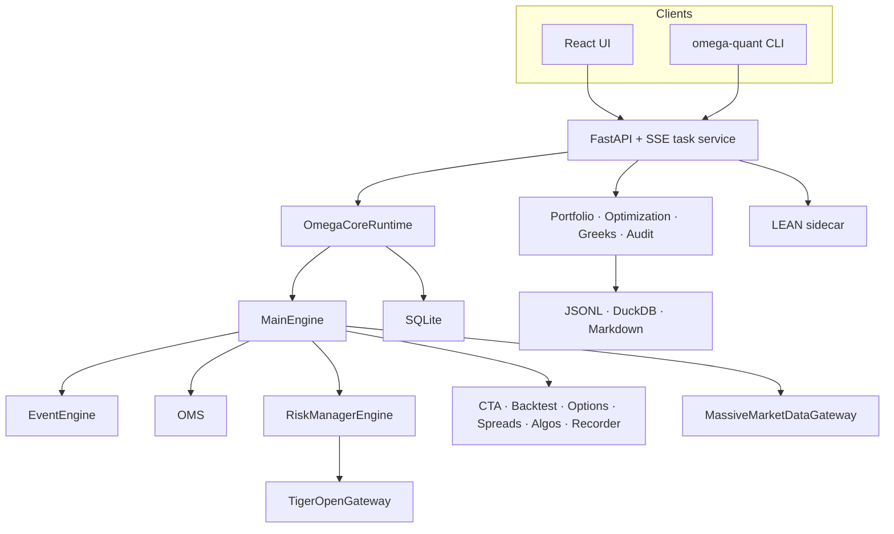

# Architecture

Omega is a single Python/React system. External providers enter through
gateways and adapters; orders have one route to the broker.

## Invariants

1. `MainEngine` is the only application entry for send/cancel actions.
2. `RiskManagerEngine` evaluates an order before the execution gateway.
3. TigerOpen `preview_order` occurs before `place_order`.
4. Live arming is process-local and starts false after every restart.
5. Read responses may be public on a local deployment; state-changing API calls
   require a header token outside explicit demo mode.
6. Account and market contexts expose masked, provider-neutral contracts.
7. Demo mode never reads local credential files or contacts external providers.

The vn.py-derived event/trader subset is vendored and headless. Omega's US
scope, gateways, safety controls, APIs, research, storage, examples and UI are
separate project code.
